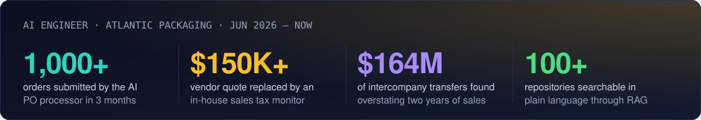
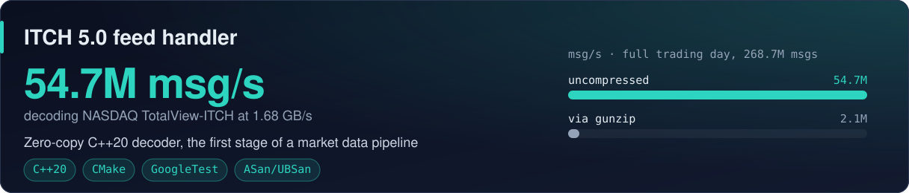
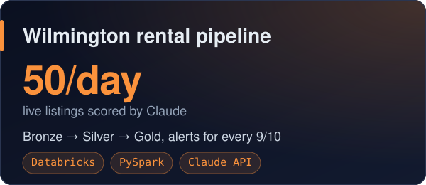
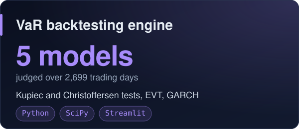
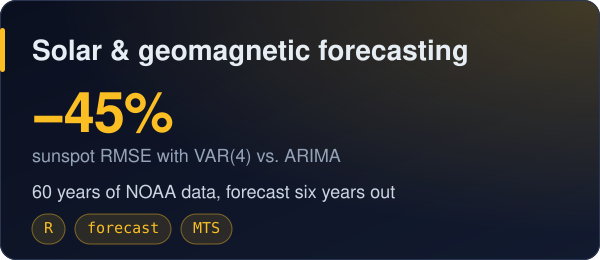
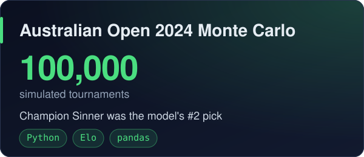

  

  
  
  

I build AI and data tools that work on top of real systems: an LLM that turns emailed purchase orders
into ERP sales orders, a monitor that checks tax rates against our ERP, and plain-language search over
our own code. On my own time it's markets, risk and forecasting. That means a C++ NASDAQ feed handler,
Value-at-Risk models put through bank-style backtests, and forecasts checked against what actually
happened.

**Now** · AI Engineer at Atlantic Packaging, building AI and data tools around its Infor A+ ERP and
owning security and access controls for a new REST API layer in front of it. 
**Before** · M.S. Computer Science and Information Systems, UNCW (May 2026), and graduate TA for 200+
students in information systems, software development and databases.

## At Atlantic Packaging

<b>How these work</b>

 

**AI purchase-order processor** · React, Python Azure Functions, Azure OpenAI 
Turns emailed customer POs into validated ERP sales orders, with sales reps reviewing and confirming
what the model produced. When telemetry traced duplicate ERP orders to timeout-triggered retries, an
idempotency guard stopped the repeats.

**Sales and use tax monitor** 
Checks official tax rate data nationwide against our Infor A+ configuration, then flags each
discrepancy with the affected ship-to locations and supporting evidence for a person to review.

**Profitability and seasonality explorer** · D3 
STL decomposition over 10 years and about 5.6M sales lines. The intercompany transfers it surfaced
are now excluded from the analysis.

**Code search with RAG** · Azure OpenAI 
Indexes GitHub and Azure DevOps repositories and answers questions grounded in the source, sending the
model only the relevant code to keep token costs low.

## Selected work

<b>Read the write-ups</b>

 

**[ITCH 5.0 feed handler](https://github.com/LukasUser/market-data-pipeline)** 
The first stage of a market data → order book → strategy pipeline. It decodes the NASDAQ
TotalView-ITCH messages that change the order book, with zero-copy framing and fixed-point prices. On
a full trading day of 268.7M messages it runs at 54.7M messages/s from an uncompressed file. CI runs
GCC and Clang, with AddressSanitizer and UBSan.

**[Wilmington rental pipeline](https://github.com/LukasUser/Wilmington-Rental-Pipeline)** 
A daily Bronze → Silver → Gold pipeline that pulls live rental listings and has Claude score each one
1–10 against our group's preferences, with pros, cons and a summary in a fixed JSON contract. A
dashboard shows the 7+ scores and a morning email flags the 9s.

**[VaR risk modeling and backtesting engine](https://github.com/LukasUser/VaR-Risk-Modeling-Backtesting-Engine)** 
Five Value-at-Risk models (historical, parametric, Monte Carlo, GARCH, EVT) forecast out-of-sample
over 2,699 trading days, then judged with Kupiec and Christoffersen tests. Normal-based models broke
2.5× too often. EVT got the rate right (1.19%), and only GARCH's failures weren't clustered.

**[Solar activity and geomagnetic forecasting](https://github.com/LukasUser/Solar-Activity-and-Geomagnetic-Forecasting)** 
60 years of monthly sunspot, F10.7 flux and Ap index data, forecast six years ahead. A VAR(4) cut
sunspot error by 45% compared with ARIMA. A dynamic regression on solar activity was the best Ap
model, at RMSE 3.15.

**[Australian Open 2024 Monte Carlo](https://github.com/LukasUser/Australian-Open-2024-Monte-Carlo-Simulation)** 
A surface-weighted Elo model frozen before the tournament, then used to play the real 128-player draw
100,000 times. Champion Jannik Sinner was its #2 pick, and it named 7 of the 8 quarterfinalists in its
top 8, one more than the seedings did.

## Tech

  
  
  
  
  
  

  
  
  
  
  
  
  

  
  
  
  
  
  
  

  
  
  
  
  
  
  
  
  
  

